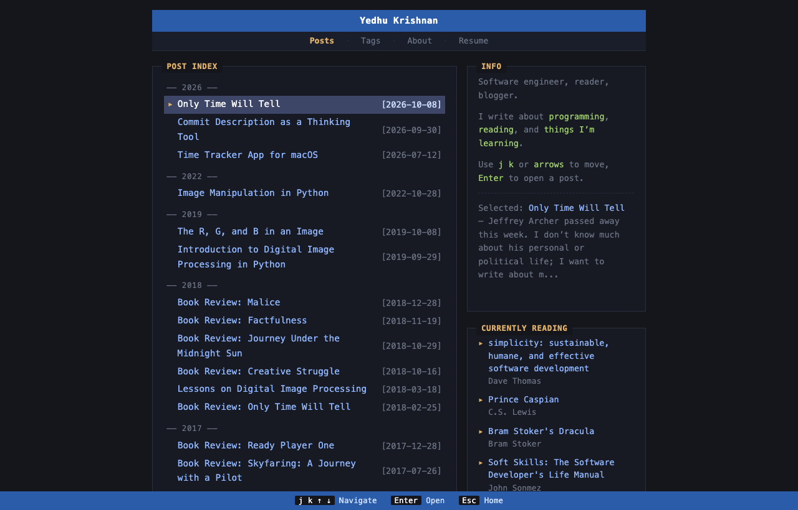
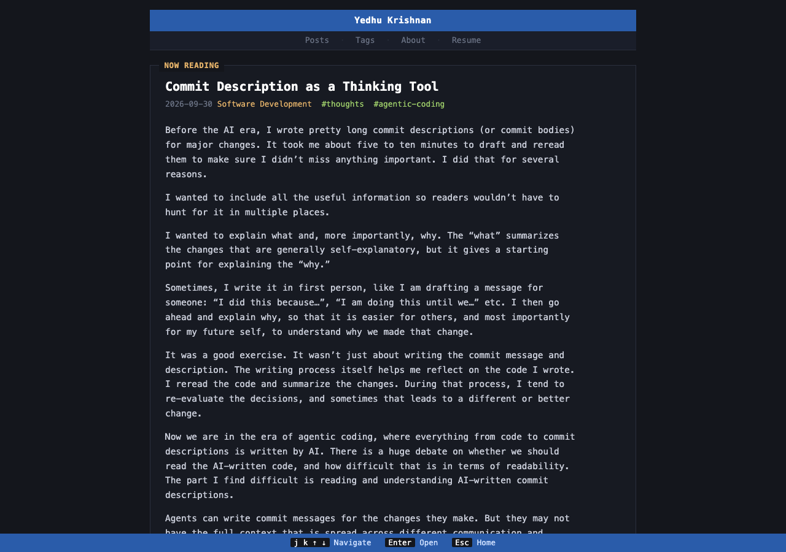
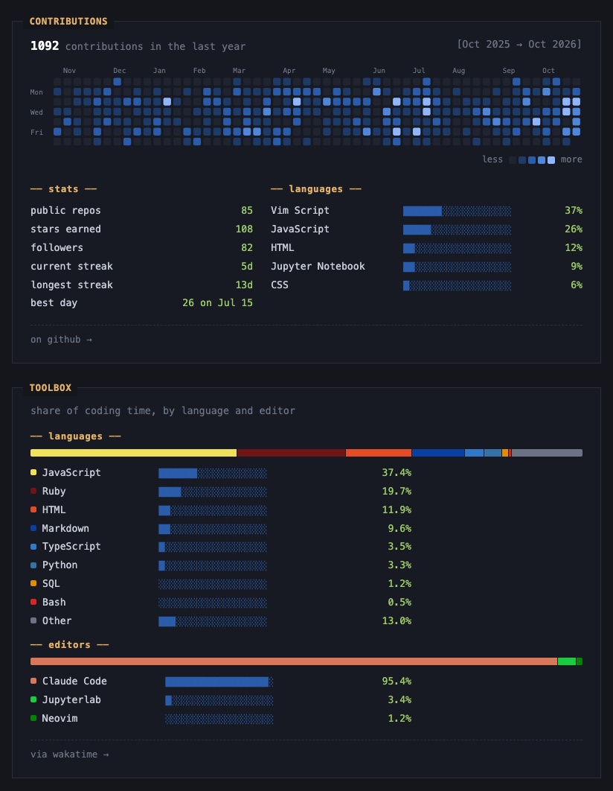
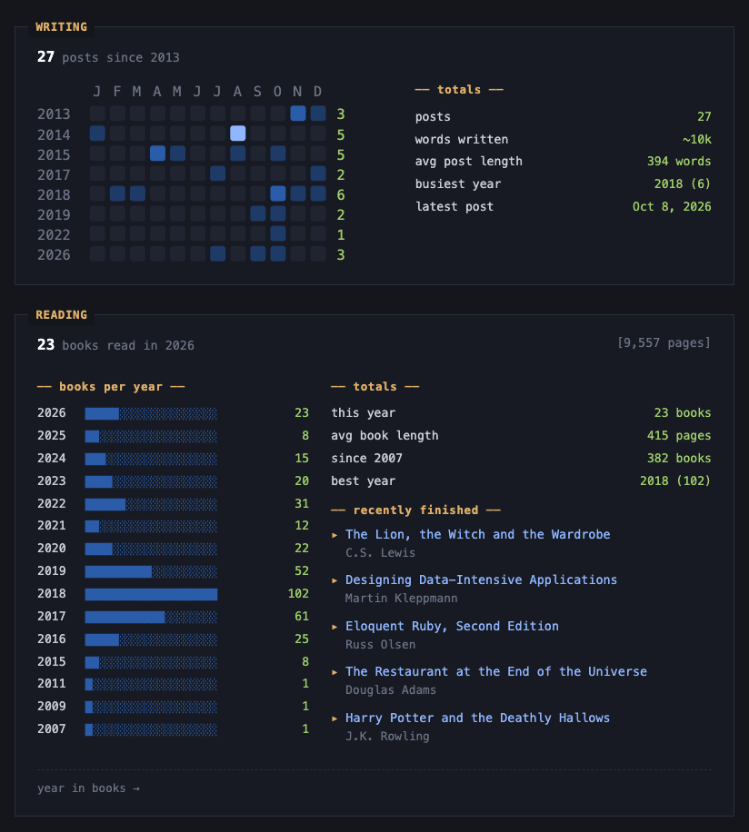

# yedhu.me

**Live site: [yedhu.me](https://yedhu.me)**

Personal blog built with Jekyll and a hand-rolled, terminal-style dark theme. The posts list supports keyboard navigation (`j`/`k` or arrows, Enter to open, Esc to go home).

> **Note:** The site itself (theme, layouts, panels and build scripts) was built with the help of [Claude](https://claude.ai). The blog posts are my own, written by me.

You're welcome to fork it and make it your own. This README explains how the pieces fit together and what to change.

## Screenshots

**Home:** the post index with keyboard selection, a preview of the selected post, and what I'm currently reading.



**Post page**



**About:** live panels for GitHub contributions and WakaTime languages and editors...



**...plus writing activity from the blog's own posts, and reading stats from Goodreads.**



## Local development

```sh
bundle install
bundle exec jekyll serve      # http://localhost:4000
```

The live panels (GitHub, WakaTime, Goodreads) read data files that are generated at build time and not committed. To see them locally, run the fetch scripts first:

```sh
ruby _scripts/fetch_goodreads.rb
ruby _scripts/fetch_wakatime.rb
GITHUB_TOKEN=$(gh auth token) ruby _scripts/fetch_github.rb
```

Without them the site still builds, and those panels are hidden.

## How the live panels work

Every panel that shows outside data follows the same pattern:

1. A Ruby script in `_scripts/` fetches the data and writes a JSON file to `_data/`.
2. An include in `_includes/` renders it with the site's own styles. If the data file is empty, the panel hides itself.
3. The deploy workflow (`.github/workflows/pages.yml`) runs the scripts before `jekyll build`, on every push and once a day, so the numbers stay fresh.

The scripts never fail the build. If a fetch fails, they write empty data and print a warning in the GitHub Actions run, so a broken source is easy to spot.

The generated files are listed in `.gitignore`, so they're never committed.

| Panel | Where | Script → data file | Include | Needs |
|---|---|---|---|---|
| Currently reading | Home | `fetch_goodreads.rb` → `currently_reading.json` | `_layouts/home.html` | Goodreads user id |
| Contributions | About | `fetch_github.rb` → `github.json` | `github_stats.html` | GitHub username, token |
| Toolbox | About | `fetch_wakatime.rb` → `wakatime.json` | `wakatime.html` | WakaTime share links |
| Writing | About | none, built from your posts | `writing_stats.html` | nothing |
| Reading | About | `fetch_goodreads.rb` → `reading.json` | `reading_stats.html` | Goodreads user id |

The About page panels are switched on in `about.md`'s front matter (`github_stats`, `wakatime`, `writing_stats`, `reading_stats`). Remove a line to hide that panel.

### Contributions (GitHub)

`_scripts/fetch_github.rb` uses the GitHub GraphQL API to get your contribution calendar, streaks, repo and star counts, followers and top languages. Set `github_username` in `_config.yml`.

It needs a token. In GitHub Actions the built-in `GITHUB_TOKEN` is enough, so there's nothing to set up. Locally, use `gh auth token`.

### Toolbox (WakaTime)

`_scripts/fetch_wakatime.rb` reads WakaTime's public share links, so it needs no API key.

1. In WakaTime, go to **Share → Embeddable Charts** (wakatime.com/share/embed).
2. Choose **Format: JSON** and a chart (Languages, Editors, ...), and copy the URL.
3. Add it under `wakatime:` in `_config.yml`, keyed by the list name:

```yaml
wakatime:
  languages: https://wakatime.com/share/@<you>/<id>.json
  editors: https://wakatime.com/share/@<you>/<id>.json
  hide:          # never shown; their share counts toward "Other"
    - Text
  allow:         # optional: the only entries a list may show
    editors:
      - Claude Code
      - Neovim
```

With `allow`, anything not named (browsers, Slack, ...) is dropped and the remaining entries are rescaled to 100%.

The panel shows the `languages` and `editors` lists. Each list shows the top 8 entries and folds the rest into "Other".

Privacy note: these lists update automatically, so any new language or editor you use will appear. Use `hide` for anything you'd rather keep private, or exclude private projects in WakaTime itself. The links only expose the chart they belong to, not your dashboard.

### Writing

`_includes/writing_stats.html` is pure Liquid: it counts your posts by month and shows a year-by-month grid (only years with posts), plus totals like words written and your busiest year. There's nothing to configure.

### Currently reading and Reading (Goodreads)

Set `goodreads.user_id` in `_config.yml`. It's the number in your profile URL: `goodreads.com/user/show/<user_id>-name`.

Goodreads retired its shelf RSS feeds in October 2026 and has no public API, so `_scripts/fetch_goodreads.rb` reads two public pages that need no sign-in:

- **Currently reading:** the bookshelf widget, the embed code Goodreads offers for blogs.
- **Reading:** your "Year in Books" pages, one per year (`goodreads.com/user/year_in_books/<year>/<user_id>`), for books and pages per year and recent finishes.

These are regular web pages, not official feeds, so a Goodreads redesign can break them. If that happens, the panels hide and the build shows a "Goodreads" warning.

Only books with a "date read" are counted in Year in Books.

## Hand-edited sections

- **Projects** (`/projects/`, not linked from the tabs): edit `_data/projects.yml`. The file's header comment lists the fields.
- **Resume** (`/resume/`): edit `_data/resume.yml` (summary, experience, projects, education and so on); `_includes/resume.html` renders it.
- **About text:** edit `about.md`.
- **Home intro:** edit `index.md`.

## Other features

- **Comments:** [giscus](https://giscus.app), backed by GitHub Discussions. Set up giscus for your repo and copy its values into `giscus:` in `_config.yml`. Comments are on for posts by default; set `comments: false` in a post's front matter to turn them off.
- **Analytics:** [GoatCounter](https://www.goatcounter.com). Set `goatcounter:` to your site code, or remove the line to turn it off. It only loads in production builds.
- **Share links and RSS:** share links are added to each post (`_includes/share.html`). The feed is at `/feed.xml` (from `jekyll-feed`) and linked in the footer.

## Forking checklist

1. Fork the repo and rename it to `<your-username>.github.io`, or use any repo name with a custom domain.
2. Edit `_config.yml`:
   - site: `title`, `description`, `url`, `timezone`
   - you: `author`, `twitter`, `social`, `github_username`
   - services: `goodreads`, `wakatime`, `giscus`, `goatcounter`. Remove any you don't use; its panel will just hide.
3. Replace the content:
   - posts: `_posts/`
   - pages: `about.md`, `index.md`
   - data files: `_data/projects.yml`, `_data/resume.yml`
   - images: `assets/img/avatar/`, `assets/img/favicons/`
4. Update the hard-coded LinkedIn link in the footer (`_layouts/default.html`).
5. Update or delete `CNAME` (it holds this site's custom domain).
6. In the repo's **Settings → Pages**, set **Source** to **GitHub Actions**.
7. Push to `main`. The workflow fetches the data, builds and deploys.

Colors and fonts are CSS variables at the top of `assets/css/style.css`.

## License

The code (theme, layouts, scripts and styles) is licensed under the [MIT License](LICENSE).

The blog posts in `_posts/` and the images in `assets/img/` are © Yedhu Krishnan,
all rights reserved. Sharing links to them is always welcome.
